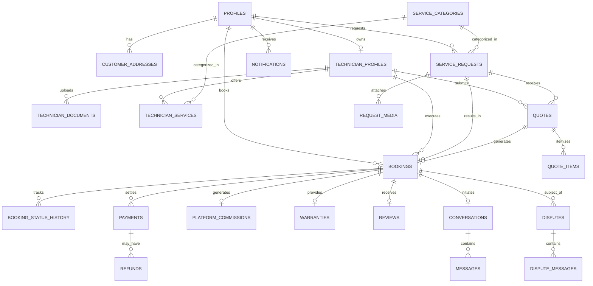

# RepairTrust Database Architecture & Entity Specifications

RepairTrust is an India-first doorstep repair services marketplace launched in Bengaluru. The backend database is built on **Supabase PostgreSQL** with strict data integrity, foreign key relations, constraints, and Row Level Security (RLS) policies.

---

## 1. High-Level Entity Relationship Diagram

---

## 2. Table Breakdown (All 26 Tables)

### User Management
| Table Name | Primary Key | Foreign Keys | Key Constraints | Description |
| :--- | :--- | :--- | :--- | :--- |
| `profiles` | `id (UUID)` | `auth.users(id)` | `role IN ('customer', 'technician', 'admin')` | Core user identity & profile record. Anti-escalation trigger prevents self-assigning admin role. |
| `customer_addresses` | `id (UUID)` | `customer_id -> profiles(id)` | `pincode VARCHAR(10)` | Bengaluru customer addresses. Protected so technicians cannot see until assigned to an active booking. |
| `technician_profiles` | `id (UUID)` | `user_id -> profiles(id)` | `verification_status IN ('pending', 'verified', 'rejected', 'under_review')` | Professional credentials, service radius, ratings, and job counters. |
| `technician_documents` | `id (UUID)` | `technician_id -> technician_profiles(id)` | `document_type IN ('aadhaar', 'driving_license', 'pan_card', ...)` | Government IDs & trade licenses. Private KYC vault accessed solely by owner and admins. |

### Service Taxonomy
| Table Name | Primary Key | Foreign Keys | Key Constraints | Description |
| :--- | :--- | :--- | :--- | :--- |
| `service_categories` | `id (UUID)` | None | `name UNIQUE`, `slug UNIQUE` | Active service categories (AC, Laptop, Washing Machine, Refrigerator, etc.). Publicly readable. |
| `technician_services` | `id (UUID)` | `technician_id`, `category_id` | `UNIQUE(technician_id, category_id)` | Services offered by individual technicians with baseline starting rates. |

### Repair Requests & Media
| Table Name | Primary Key | Foreign Keys | Key Constraints | Description |
| :--- | :--- | :--- | :--- | :--- |
| `service_requests` | `id (UUID)` | `customer_id`, `category_id`, `address_id` | `request_status IN ('draft', 'open', 'quoted', 'booked', ...)` | Doorstep service requests logged by Bengaluru customers with symptoms and preferred slots. |
| `request_media` | `id (UUID)` | `request_id -> service_requests(id)` | `media_type IN ('image', 'video', ...)` | Photo/video evidence of appliance faults uploaded by customers. |

### Quotations & Transparent Pricing
| Table Name | Primary Key | Foreign Keys | Key Constraints | Description |
| :--- | :--- | :--- | :--- | :--- |
| `quotes` | `id (UUID)` | `request_id`, `technician_id` | `total_amount >= 0`, `quote_status IN ('pending', 'accepted', ...)` | Transparent quotations breaking down diagnosis, labor, parts, and taxes. |
| `quote_items` | `id (UUID)` | `quote_id -> quotes(id)` | `quantity > 0`, `unit_price >= 0` | Granular line items detailing exact parts and labor components. |

### Bookings & Execution
| Table Name | Primary Key | Foreign Keys | Key Constraints | Description |
| :--- | :--- | :--- | :--- | :--- |
| `bookings` | `id (UUID)` | `request_id`, `quote_id`, `customer_id`, `technician_id` | `booking_status IN ('confirmed', 'arrived', 'in_progress', 'completed', ...)` | Confirmed doorstep repair appointment agreed between customer and technician. |
| `booking_status_history`| `id (UUID)` | `booking_id -> bookings(id)` | `changed_by -> profiles(id)` | Tamper-proof audit log tracking status transitions with timestamps and notes. |

### Financial Settlements & Integrity
| Table Name | Primary Key | Foreign Keys | Key Constraints | Description |
| :--- | :--- | :--- | :--- | :--- |
| `payments` | `id (UUID)` | `booking_id`, `customer_id` | `currency = 'INR'`, `amount >= 0` | Digital UPI, Card, Netbanking, or Cash transactions. Payment status can only be set via server webhook. |
| `platform_commissions` | `id (UUID)` | `booking_id UNIQUE`, `technician_id` | `commission_percentage BETWEEN 0 AND 100` | Weekly technician direct bank settlements with transparent commission logs. |
| `refunds` | `id (UUID)` | `payment_id -> payments(id)` | `amount > 0` | Customer refunds initiated in dispute resolutions or warranty claims. |

### Warranties & Reviews
| Table Name | Primary Key | Foreign Keys | Key Constraints | Description |
| :--- | :--- | :--- | :--- | :--- |
| `warranties` | `id (UUID)` | `booking_id UNIQUE`, `customer_id`, `technician_id` | `warranty_period_days > 0` | 30 to 90 days doorstep warranty certificates with start and expiry dates. |
| `reviews` | `id (UUID)` | `booking_id UNIQUE`, `customer_id`, `technician_id` | `rating BETWEEN 1 AND 5` | Authentic feedback loop. `UNIQUE(booking_id)` strictly prohibits duplicate reviews. |

### Messaging & Notifications
| Table Name | Primary Key | Foreign Keys | Key Constraints | Description |
| :--- | :--- | :--- | :--- | :--- |
| `conversations` | `id (UUID)` | `booking_id UNIQUE` | None | Dedicated communication channels initiated on confirmed bookings. |
| `conversation_participants` | `id (UUID)` | `conversation_id`, `user_id` | `UNIQUE(conversation_id, user_id)` | Authorized conversation members (customer and assigned technician). |
| `messages` | `id (UUID)` | `conversation_id`, `sender_id` | None | In-app chat messages with optional attachment paths. |
| `notifications` | `id (UUID)` | `user_id -> profiles(id)` | `is_read BOOLEAN` | Real-time alerts for quote submissions, booking status changes, and warranties. |

### Customer Support & Administration
| Table Name | Primary Key | Foreign Keys | Key Constraints | Description |
| :--- | :--- | :--- | :--- | :--- |
| `disputes` | `id (UUID)` | `booking_id`, `customer_id`, `technician_id` | `dispute_status IN ('opened', 'investigating', 'resolved', 'dismissed')` | Escalation tickets reviewed by the Bengaluru customer ombudsman. |
| `dispute_messages` | `id (UUID)` | `dispute_id -> disputes(id)` | `sender_id -> profiles(id)` | Mediation dialogue between customer, technician, and dispute manager. |
| `coupons` | `id (UUID)` | None | `code UNIQUE`, `discount_type IN ('percentage', 'fixed_amount')` | Promotional coupons with minimum order values and expiry dates. |
| `coupon_redemptions` | `id (UUID)` | `coupon_id`, `customer_id`, `booking_id` | `UNIQUE(coupon_id, customer_id, booking_id)` | Verified coupon redemption ledger preventing duplicate discount misuse. |
| `audit_logs` | `id (UUID)` | `actor_id -> profiles(id)` | None | Immutable system audit log. Read-only to administrators; cannot be updated or deleted. |
